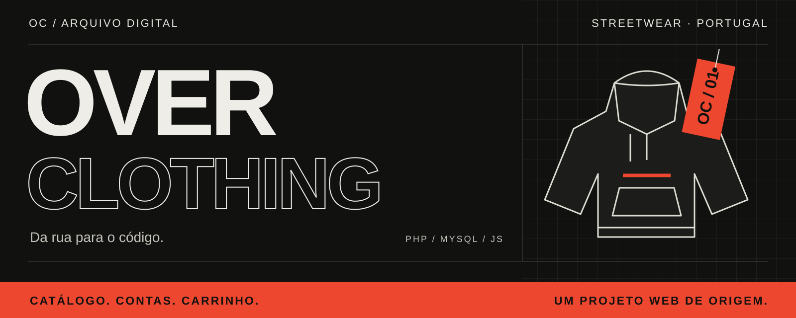
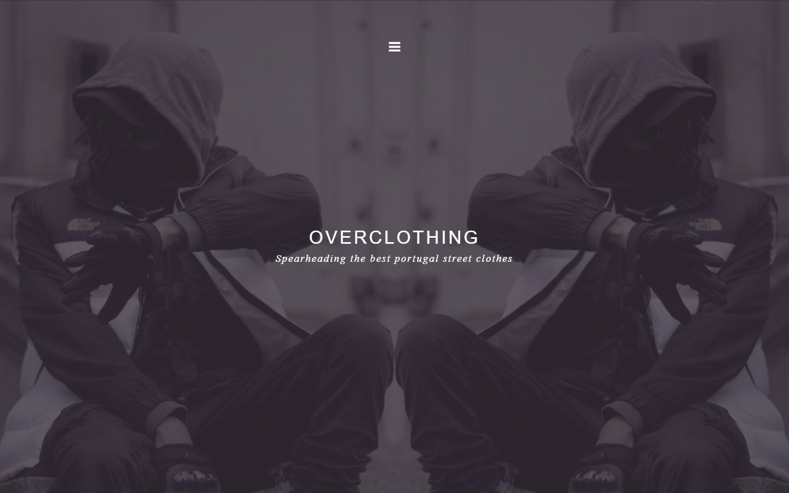
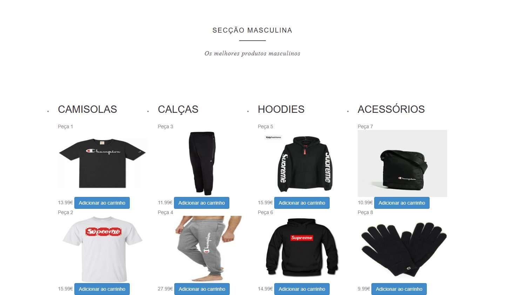

<p align="center">
  
</p>

# 🧥 OverClothing

**Uma loja de streetwear. Um retrato dos primeiros passos no desenvolvimento web.**

Catálogo para homem, mulher e criança, registo de utilizadores, área de administração e um carrinho feito em JavaScript. O OverClothing junta interface, sessões PHP e duas bases de dados MySQL num projeto sem framework de aplicação nem processo de build.

**🎓 Projeto de aprendizagem · 📦 Código legado · 💻 Execução local**

[📸 Ver o projeto](#-um-olhar-pela-loja) · [🔌 Explorar o código](#-como-se-liga) · [🚀 Preparar o ambiente](#-preparar-o-ambiente-local) · [🚧 Limites atuais](#-o-que-falta-para-uma-loja-real)

---

## 📸 Um olhar pela loja

<p align="center">
  
</p>

<p align="center"><sub>A entrada: fotografia a preto e branco, nome da marca e navegação por secções.</sub></p>

<p align="center">
  
</p>

<p align="center"><sub>O catálogo: peças, preços e acesso ao carrinho na mesma página.</sub></p>

Estas imagens são **pré-visualizações estáticas do HTML/CSS existente**, com os recursos locais do projeto. Os blocos PHP foram omitidos na captura: não representam uma sessão autenticada, produtos carregados da base de dados ou um teste completo da loja. A capa é uma ilustração editorial criada para este README.

## 🛒 Do catálogo ao carrinho

| Área | O que está implementado no código |
| --- | --- |
| **🧥 Vitrine** | Uma página com secções de homem, mulher e criança, categorias de roupa e imagens locais. |
| **🛒 Carrinho** | Adicionar e remover artigos, alterar quantidades e recalcular o total em JavaScript. O estado vive na página. |
| **👤 Contas** | Registo, login e sessões PHP, com distinção entre utilizador e administrador. |
| **🏷️ Produtos** | Leitura de produtos MySQL na secção masculina e formulário de inserção com imagem, preço e categoria. |
| **🛍️ Compra demonstrativa** | O botão «Comprar» mostra uma mensagem e limpa o carrinho. Não cria uma encomenda nem processa pagamentos. |

A vitrine mistura artigos escritos diretamente no HTML com uma consulta à tabela `product`. A existência de categorias no formulário de administração não significa que o catálogo já filtre os produtos por categoria.

## 🔌 Como se liga

O projeto separa os dados de contas e os dados de produtos em duas bases MySQL. O carrinho é tratado no navegador.

```text
NAVEGADOR                         SERVIDOR PHP                   MYSQL

login.php / register.php  ───────► functions.php ───────────────► multi_login
                                 sessões e contas                └─ users

index.php                ───────► consulta de produtos ─────────► overclothing
add_product.php          ───────► inserção + upload ─────────────► └─ product

store.js                 ───────► carrinho no DOM
                                 sem persistência de encomendas
```

| Tecnologia | Papel no projeto |
| --- | --- |
| PHP + MySQLi | Pedidos, sessões, registo, login e acesso aos dados. |
| MySQL | Tabelas de utilizadores e produtos, com dumps SQL incluídos. |
| HTML + CSS + Bootstrap | Estrutura e apresentação da loja e dos formulários. |
| JavaScript | Comportamento do carrinho, quantidades e total. |
| jQuery e plugins locais | Navegação, slideshow e efeitos da interface. |

<details>
<summary><strong>📂 Mapa dos ficheiros</strong></summary>

```text
Site-overclothing/
├── index.php                 Vitrine e consulta de produtos
├── store.js                  Carrinho no navegador
├── functions.php             Sessões, registo, login e ligação de contas
├── login.php / register.php  Formulários de acesso
├── add_product.php           Inserção de produtos e upload
├── admin/                    Páginas de administração e criação de contas
├── TabelasSqlOverClothing/   Dumps de multi_login e overclothing
├── css/ · js/ · fonts/       Estilos, bibliotecas e fontes locais
├── images/                   Fotografias e imagens do catálogo
└── docs/images/              Recursos visuais deste README
```

O handler de contacto em `php/contact.php` usa uma API PHP antiga e um destinatário de exemplo; a sua presença não representa um serviço de email configurado.

</details>

## 🚀 Preparar o ambiente local

Este é um procedimento de preparação baseado no código, **ainda sem validação de execução de PHP/MySQL nesta revisão**. Não existe uma versão atual de PHP certificada para este projeto. Os cabeçalhos dos dumps registam PHP 5.4.17 e MySQL 5.6.13 no ambiente de origem; são referências históricas, não versões recomendadas para instalar.

### 1. 📥 Obter o projeto

```bash
git clone https://github.com/Johnnyzao/Site-overclothing.git
cd Site-overclothing
```

É necessário um ambiente local com **PHP, extensão `mysqli` e servidor MySQL**. Não há dependências Composer ou npm para instalar. Abrir o ficheiro PHP diretamente no navegador ou usar apenas um servidor estático não executa a aplicação.

### 2. 🗄️ Preparar as duas bases de dados

Num servidor local de desenvolvimento, importar através do cliente MySQL ou do phpMyAdmin:

| Dump | Base e tabela |
| --- | --- |
| [`multi_login.sql`](TabelasSqlOverClothing/multi_login.sql) | `multi_login.users` |
| [`overclothing.sql`](TabelasSqlOverClothing/overclothing.sql) | `overclothing.product` |

Os dumps incluem `CREATE DATABASE`, `USE` e dados de exemplo. Inspeciona-os antes de importar e usa bases isoladas, sem dados reais.

### 3. ⚙️ Ajustar as ligações e os caminhos

O código original tem configuração MySQL diretamente nos ficheiros. Substitui os valores locais nas chamadas `mysqli_connect` de:

- [`functions.php`](functions.php), para as contas em `multi_login`;
- [`index.php`](index.php), para o catálogo em `overclothing`;
- [`add_product.php`](add_product.php), para a inserção em `overclothing`.

Há também uma diferença de caminhos a resolver antes de testar uploads: o formulário grava em `./product_image/`, mas a vitrine procura as imagens dinâmicas em `./admin/product_image/`. Essas pastas e as imagens referidas no dump de produtos não acompanham esta cópia. As imagens estáticas do catálogo estão em `images/`.

### 4. ▶️ Iniciar o servidor PHP

Com PHP disponível no `PATH`, a extensão MySQLi ativa e o MySQL preparado, executar na raiz:

```bash
php -S 127.0.0.1:8080
```

Abrir **http://127.0.0.1:8080/login.php**. O registo está em `/register.php`; a vitrine, em `/index.php`. O servidor integrado serve apenas para desenvolvimento local.

Depois de iniciar, verificar manualmente registo, login, acesso à vitrine, carrinho e inserção de produtos. O repositório não inclui uma suite de testes automatizados.

## 🚧 O que falta para uma loja real

O valor deste repositório está no percurso de aprendizagem: construir uma vitrine, ligar formulários a dados e dar comportamento à página.

Para o transformar numa loja operacional seria necessário trabalho adicional. O código usa MD5 nas palavras-passe, SQL construído por concatenação e upload sem validação robusta; a página de inserção de produtos também precisa de controlo de acesso consistente. Estes pontos exigem revisão antes de qualquer exposição pública.

Também existem referências a estilos e recursos em falta, diferenças de caminhos e bibliotecas antigas. Não há pagamentos, persistência de encomendas, gestão de stock ou confirmação de envio implementados no fluxo de compra.

## 🤝 Autoria e recursos

Projeto preservado no GitHub de **[Johnnyzao](https://github.com/Johnnyzao)**. Fotografias, marcas, fontes e bibliotecas incluídas mantêm os direitos dos respetivos titulares. A origem individual das fotografias não está documentada nesta cópia; não são apresentadas como criações originais do projeto.

O repositório não contém uma licença de distribuição própria. Este README não atribui uma nem altera os direitos sobre o código ou os recursos incluídos.

---

<p align="center"><strong>OverClothing 🧥</strong><br /><sub>Da rua para o código. Parte do percurso. ⚡</sub></p>
